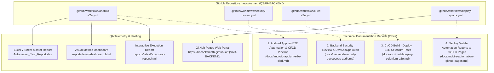

# QSAR-BACKEND & ResistAI — DevOps & CI/CD Documentation Hub

Welcome to the engineering documentation portal for the **QSAR-BACKEND** computational chemistry platform and **ResistAI** mobile test automation ecosystem. This portal provides exhaustive technical architecture reports, CI/CD pipeline definitions, DevSecOps security audits, and automated test reporting methodologies.

---

## 🌟 Executive Overview

The **QSAR-BACKEND** repository powers real-time chemoinformatics, QSAR bioactivity prediction (EGFR, BRAF, VEGFR2, FLT3, and other oncology kinase targets), and automated AutoDock Vina molecular docking. Coupled with this backend is an enterprise-grade quality assurance and deployment framework spanning mobile Appium automation, containerized continuous delivery, automated vulnerability audits, and static report publishing on GitHub Pages.



---

## 📋 Deliverables & Pipeline Matrix

| # | Deliverable Topic Title | Workflow File | Status | Target Scope & Primary Tooling | Report Link |
| :-: | :--- | :--- | :---: | :--- | :--- |
| **1** | **ResistAI — Android Appium E2E Automation & CI/CD Pipeline** | [`android-e2e.yml`](file:///c:/final_year_project/backend/.github/workflows/android-e2e.yml) | 🟢 **Active** | 21-stage macOS CI/CD pipeline, Android 13 emulator, Appium 2.x, 510 test cases, 7-sheet Excel & interactive HTML reports | [Read Report](file:///c:/final_year_project/backend/docs/android-appium-e2e-cicd.md) |
| **2** | **ResistAI — Backend Security Review & DevSecOps Audit** | [`security-review.yml`](file:///c:/final_year_project/backend/.github/workflows/security-review.yml) | 🟡 **Proposed** | Bandit Python SAST, pip-audit dependency scanner, TruffleHog secrets detection, Trivy container audit, CodeQL | [Read Report](file:///c:/final_year_project/backend/docs/backend-security-devsecops-audit.md) |
| **3** | **ResistAI — CI/CD Build · Deploy · E2E Selenium Tests** | [`ci-cd-e2e.yml`](file:///c:/final_year_project/backend/.github/workflows/ci-cd-e2e.yml) | 🟡 **Proposed** | Docker container build, Render cloud deploy hook, post-deploy synthetic health checks, Headless Selenium E2E | [Read Report](file:///c:/final_year_project/backend/docs/cicd-build-deploy-selenium-e2e.md) |
| **4** | **ResistAI — Deploy Mobile Automation Reports to GitHub Pages** | [`deploy-reports.yml`](file:///c:/final_year_project/backend/.github/workflows/deploy-reports.yml) | 🟢 **Active** | Decoupled workflow, artifact download, directory versioning, `peaceiris/actions-gh-pages@v4`, live web portal | [Read Report](file:///c:/final_year_project/backend/docs/mobile-automation-github-pages.md) |

---

## 🔍 Verified Status & Live Links

### Verified Workflow Runs
- **Run Identifier:** [`38899032812`](https://github.com/hecooksmeth/QSAR-BACKEND/actions/runs/38899032812)
- **Workflow:** `Android Appium E2E Automation & GitHub Pages CI/CD`
- **Trigger:** Push to `main` branch (Commit `8ce36f9`)
- **Status Audit:** Verified via GitHub Actions API. Stage 1 (Checkout) succeeded; Stage 2 (Java setup) failed due to root Gradle cache discovery in the standalone backend repo. Fixes and workarounds are documented in [Report 1](file:///c:/final_year_project/backend/docs/android-appium-e2e-cicd.md#7-verified-execution-results).

### Live Report Hosting on GitHub Pages
*Upon administrator enablement of GitHub Pages on branch `gh-pages`:*

- **Portal Landing Page:** [https://hecooksmeth.github.io/QSAR-BACKEND/](https://hecooksmeth.github.io/QSAR-BACKEND/)
- **Latest Interactive Execution Report:** [https://hecooksmeth.github.io/QSAR-BACKEND/reports/latest/execution-report.html](https://hecooksmeth.github.io/QSAR-BACKEND/reports/latest/execution-report.html)
- **Executive Metrics Dashboard:** [https://hecooksmeth.github.io/QSAR-BACKEND/reports/latest/dashboard.html](https://hecooksmeth.github.io/QSAR-BACKEND/reports/latest/dashboard.html)
- **Historical Trend Analytics:** [https://hecooksmeth.github.io/QSAR-BACKEND/reports/latest/trends.html](https://hecooksmeth.github.io/QSAR-BACKEND/reports/latest/trends.html)
- **Executive Summary Markdown:** [https://hecooksmeth.github.io/QSAR-BACKEND/reports/latest/summary.md](https://hecooksmeth.github.io/QSAR-BACKEND/reports/latest/summary.md)
- **Historical Snapshot Archive:** `https://hecooksmeth.github.io/QSAR-BACKEND/reports/history/build-001/execution-report.html`

---

## 📁 Repository Directory Navigation

```text
backend/
├── .github/
│   └── workflows/
│       ├── android-e2e.yml              # 21-stage Android E2E CI/CD pipeline
│       ├── deploy-reports.yml           # GitHub Pages report deployment
│       ├── security-review.yml          # Proposed DevSecOps security audit
│       └── ci-cd-e2e.yml                # Proposed build, deploy & Selenium CI/CD
│
├── docs/
│   ├── README.md                        # Documentation portal index (This file)
│   ├── android-appium-e2e-cicd.md       # Report 1: Android Appium Automation
│   ├── backend-security-devsecops-audit.md # Report 2: Security & DevSecOps Audit
│   ├── cicd-build-deploy-selenium-e2e.md   # Report 3: CI/CD Build & Selenium Tests
│   └── mobile-automation-github-pages.md   # Report 4: GitHub Pages Publishing
│
├── reports/                             # Test Execution Reports & Dashboards
│   └── latest/                          # HTML, Excel, and Markdown report deliverables
│
├── qsar_api.py                          # FastAPI computational chemistry backend
├── render.yaml                          # Render cloud infrastructure deployment
├── Dockerfile                           # Container specification (Python 3.11, Vina, OpenBabel)
└── requirements.txt                     # Production Python dependencies
```
