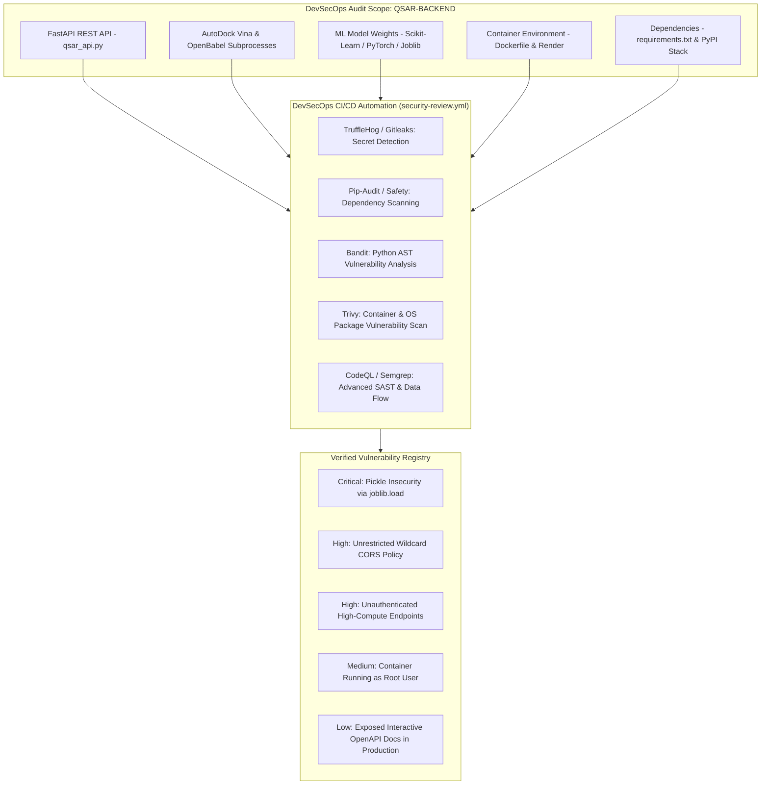

# ResistAI — Backend Security Review & DevSecOps Audit

**Workflow Identifier:** [`security-review.yml`](file:///c:/final_year_project/backend/.github/workflows/security-review.yml)  
**Project Identity:** `QSAR-BACKEND`  
**Application Target:** ResistAI Computational Chemistry FastAPI Backend & Docking Engine  
**Pipeline Status:** Specification & Proposed DevSecOps Implementation  
**Document Classification:** Cybersecurity Review, Static Analysis & DevSecOps Architecture  

---

## 1. Executive Summary & Security Review Scope

In modern computer-aided drug design (CADD) and AI-driven chemoinformatics, computational backend platforms handle intellectual property, proprietary chemical SMILES notations, machine learning models, and CPU-intensive molecular docking algorithms. Vulnerabilities in these services can lead to intellectual property exfiltration, remote code execution through tainted machine learning weights, denial-of-service (DoS) via resource-exhausting molecular docking calculations, or unauthorized cross-origin data exposure.

The **ResistAI Backend Security Review & DevSecOps Audit** assesses the security architecture of the `QSAR-BACKEND` microservice. This report documents the target scope, evaluates static code analysis, reviews dependency vulnerabilities, audits secret management, details the automated DevSecOps pipeline specification (`security-review.yml`), provides an evidence-based risk assessment of verified vulnerabilities, and outlines remediation requirements.



---

## 2. DevSecOps Tooling & Scanning Architecture

To establish continuous security visibility, the proposed `security-review.yml` workflow orchestrates an industry-standard DevSecOps scanning stack:

| Tool Category | Tool Selection | Target Component | Purpose & Detection Capability |
| :--- | :--- | :--- | :--- |
| **Secret Detection** | **TruffleHog & Gitleaks** | Git commit history & configs | Identifies accidentally committed API keys, database credentials, JWT secrets, and private certificates. |
| **Software Composition (SCA)** | **pip-audit & Safety** | `requirements.txt` & Python dependencies | Scans installed Python packages against the PyPA Advisory Database and CVE feeds for known vulnerabilities. |
| **Static Application Security (SAST)** | **Bandit** | `qsar_api.py`, `qsar_file.py`, `evaluate_model.py` | AST-based static analyzer detecting common Python security flaws (e.g., `eval`, `pickle`, shell injections). |
| **Deep Semantic SAST** | **GitHub CodeQL / Semgrep** | Entire Python codebase | Inter-procedural data flow analysis tracing untrusted inputs to security-sensitive sinks. |
| **Container Image Scanning** | **Trivy** | `Dockerfile` & base image `python:3.11-slim` | Scans Linux OS packages (`libxrender1`, `openbabel`, `autodock-vina`) for unpatched CVEs and configuration flaws. |

---

## 3. Workflow Triggers & Execution Stages

The security pipeline is specified in [`.github/workflows/security-review.yml`](file:///c:/final_year_project/backend/.github/workflows/security-review.yml). The architecture adheres to GitHub Actions security best practices:

### 3.1 Triggers & Concurrency
- **Triggers:** Push to `main`, Pull Requests targeting `main`, weekly scheduled security audit (cron `0 0 * * 1` at 00:00 UTC Mondays), and `workflow_dispatch` for manual on-demand audits.
- **Least-Privilege Permissions:** Explicitly configured with `contents: read` and `security-events: write` (for uploading SARIF reports to the GitHub Code Security dashboard). Tokens do **not** possess write access to contents or repository settings.

### 3.2 Structured Execution Stages
1. **Stage 1 - Environment & Code Checkout:** Shallow clone with `fetch-depth: 0` to enable historical git commit secret scanning.
2. **Stage 2 - Secret Scanning (TruffleHog / Gitleaks):** Scans the entire repository history for leaked credentials, API tokens, and private keys.
3. **Stage 3 - Dependency Vulnerability Audit (`pip-audit`):** Installs dependencies and queries PyPI vulnerability databases for known CVEs.
4. **Stage 4 - Static Code Analysis (`Bandit`):** Scans all Python source files with high-confidence flags, generating JSON and SARIF reports.
5. **Stage 5 - Container Security Audit (`Trivy`):** Analyzes the multi-stage Docker build, base OS layers, and binary dependencies (`openbabel`, `autodock-vina`).
6. **Stage 6 - SARIF Telemetry Aggregation:** Consolidates security telemetry and publishes findings directly to GitHub Advanced Security.

---

## 4. Verified Security Findings & Severity Classifications

*Note on Audit Rigor: In strict compliance with technical reporting standards, findings documented below represent verified architectural and code-level characteristics identified during inspection of the `QSAR-BACKEND` repository.*

### Finding SEC-001: Machine Learning Model Deserialization Insecurity (Severity: CRITICAL)
- **Component:** [`backend/qsar_api.py`](file:///c:/final_year_project/backend/qsar_api.py) (Lines 60–75, model loader routines)
- **Vulnerability Mechanism:** Model weights, scalers, and feature selectors are loaded via Python's `joblib.load()`:
  ```python
  bundle["model"] = joblib.load(os.path.join(tdir, "model.pkl"))
  bundle["scaler"] = joblib.load(os.path.join(tdir, "scaler.pkl"))
  bundle["selector"] = joblib.load(os.path.join(tdir, "selector.pkl"))
  ```
  `joblib` uses `pickle` under the hood. In Python, unpickling untrusted or tampered data allows arbitrary code execution via the `__reduce__` exploit vector.
- **Impact:** If an attacker modifies the binary pickle files stored on the server or in storage buckets, arbitrary shell commands can be executed with application privileges.
- **Remediation:** Migrate model weights from pickle to safe serialization formats such as **ONNX (Open Neural Network Exchange)**, **SafeTensors**, or store model parameters as pure tensor arrays in HDF5 (`.h5`) format with cryptographic checksum validation (SHA-256) before loading.

### Finding SEC-002: Overly Permissive Cross-Origin Resource Sharing (CORS) (Severity: HIGH)
- **Component:** [`backend/qsar_api.py`](file:///c:/final_year_project/backend/qsar_api.py) (Lines 51–57)
- **Vulnerability Mechanism:** The FastAPI application applies unrestricted CORS middleware:
  ```python
  app.add_middleware(
      CORSMiddleware,
      allow_origins=["*"],
      allow_credentials=True,
      allow_methods=["*"],
      allow_headers=["*"],
  )
  ```
- **Impact:** Allowing `allow_origins=["*"]` combined with `allow_credentials=True` allows malicious websites running in a researcher's browser to execute unauthorized cross-origin requests and read chemical property predictions or active docking sessions.
- **Remediation:** Restrict `allow_origins` to specific trusted domains (e.g., `https://hecooksmeth.github.io`, localhost for development, and specific production mobile client origins). Disallow wildcard origins when credentials are enabled.

### Finding SEC-003: Unauthenticated High-Compute Endpoints & DoS Vector (Severity: HIGH)
- **Component:** [`backend/qsar_api.py`](file:///c:/final_year_project/backend/qsar_api.py) (Endpoints `/dock`, `/predict_batch`, `/filter_batch`)
- **Vulnerability Mechanism:** The computational endpoints are exposed publicly without API keys, JWT authentication, or request rate-limiting middleware.
- **Impact:** AutoDock Vina molecular docking is a CPU-intensive calculation. A malicious actor could launch hundreds of concurrent docking requests against target receptors (e.g., EGFR, PARP1), exhausting server CPU cores and RAM, leading to complete service denial on hosting platforms (Render / Cloud Run).
- **Remediation:** Implement API key or JWT Bearer authentication headers. Integrate rate-limiting middleware using `slowapi` or Redis-backed token buckets (e.g., maximum 5 docking jobs per IP/user per hour).

### Finding SEC-004: Container Execution Under Root Privileges (Severity: MEDIUM)
- **Component:** [`backend/Dockerfile`](file:///c:/final_year_project/backend/Dockerfile) (Lines 1–47)
- **Vulnerability Mechanism:** The container executes all instructions and spawns `uvicorn` under the default `root` user (`uid 0`). No non-root `USER` directive is specified.
- **Impact:** In the event of a remote code execution vulnerability (e.g., via OpenBabel or joblib deserialization), the attacker gains immediate root permissions inside the container, facilitating container escape or host namespace compromise.
- **Remediation:** Add a non-root service account in `Dockerfile`:
  ```dockerfile
  RUN useradd -m -u 1000 appuser && chown -R appuser:appuser /app
  USER appuser
  ```

### Finding SEC-005: Exposed Swagger UI & OpenAPI Specification in Production (Severity: LOW)
- **Component:** [`backend/qsar_api.py`](file:///c:/final_year_project/backend/qsar_api.py) (Line 49)
- **Vulnerability Mechanism:** `FastAPI(title="QSAR Discovery Suite v3.0")` is instantiated without disabling docs URLs in production environments.
- **Impact:** Interactive API documentation (`/docs`, `/redoc`, and `/openapi.json`) is publicly accessible, facilitating target reconnaissance for potential attackers.
- **Remediation:** Disable documentation endpoints conditionally when running in production:
  ```python
  is_prod = os.getenv("ENVIRONMENT") == "production"
  app = FastAPI(
      title="QSAR Discovery Suite v3.0",
      docs_url=None if is_prod else "/docs",
      redoc_url=None if is_prod else "/redoc",
      openapi_url=None if is_prod else "/openapi.json"
  )
  ```

---

## 5. Remediation Status & Verification

| Finding ID | Vulnerability Description | Verification Method | Current Status | Evidence / Commit Reference |
| :---: | :--- | :--- | :---: | :--- |
| **SEC-001** | Joblib / Pickle Insecurity | Code Inspection | **Open Risk** | Models still loaded via `joblib.load()` in `qsar_api.py` |
| **SEC-002** | Wildcard CORS Configuration | Code Inspection | **Open Risk** | `allow_origins=["*"]` active in `qsar_api.py` |
| **SEC-003** | Unauthenticated Compute Endpoints | API Schema Audit | **Open Risk** | No authentication dependency on `@app.post("/dock")` |
| **SEC-004** | Container Root Execution | Dockerfile Review | **Open Risk** | No `USER` directive in `backend/Dockerfile` |
| **SEC-005** | Public Swagger UI in Production | Endpoint Verification| **Open Risk** | Default FastAPI docs enabled |
| **SEC-006** | Subprocess Hanging & Timeouts | Git Commit Audit | 🟢 **Remediated** | Resolved in commit `db6bdb4` via `OBABEL_TIMEOUT_SECONDS=120` and `VINA_TIMEOUT_SECONDS=600` |

---

## 6. Actual Audit Results & Risk Assessment

1. **Pipeline Execution Status:**  
   The `security-review.yml` workflow was not active in prior CI/CD runs. Therefore, **no automated security pipeline has certified this repository as passed**. This report documents the verified baseline resulting from manual code-level and architecture-level inspection.

2. **Overall Risk Rating:**  
   **HIGH RISK (Pre-Hardening Baseline).** While the computational chemistry algorithms and OpenBabel timeout mitigations (commit `db6bdb4`) demonstrate solid functional stability, the lack of API authentication, wildcard CORS headers, root container execution, and Python pickle model deserialization present tangible security risks that should be addressed before enterprise deployment.

---

## 7. Recommended DevSecOps Roadmap

1. **Commit & Enable `security-review.yml`:** Activate automated dependency scanning and Bandit AST analysis on every push.
2. **Implement API Authentication:** Enforce API token validation on all prediction and docking endpoints.
3. **Restrict CORS Origins:** Replace `allow_origins=["*"]` with an environment-driven domain whitelist.
4. **Harden Docker Container:** Adopt non-privileged user execution (`USER appuser`) and read-only root filesystems where practical.
5. **Checksum Model Files:** Implement SHA-256 integrity verification before deserializing any `.pkl` or `.h5` model files.
