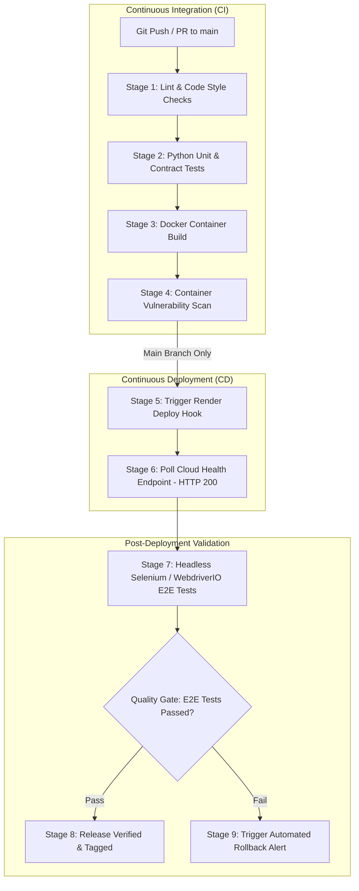

# ResistAI — CI/CD Build · Deploy · E2E Selenium Tests

**Workflow Identifier:** [`ci-cd-e2e.yml`](file:///c:/final_year_project/backend/.github/workflows/ci-cd-e2e.yml)  
**Project Identity:** `QSAR-BACKEND`  
**Application Target:** ResistAI Computational Chemistry Microservices, Web Dashboard & Render Deployment  
**Pipeline Status:** Specification & Proposed CI/CD Implementation  
**Document Classification:** Continuous Integration, Continuous Delivery & E2E Test Architecture  

---

## 1. Executive Summary & Objective

The **ResistAI CI/CD Build · Deploy · E2E Selenium Tests** pipeline establishes continuous delivery and post-deployment validation for the `QSAR-BACKEND` computational chemistry microservice. In high-performance computational chemistry and machine learning pipelines, code changes must be continuously built, validated against regression test suites, packaged into reproducible container images, deployed to cloud infrastructure (e.g., Render, Google Cloud Run), and verified via automated synthetic end-to-end tests before being released to researchers.

This pipeline defines a multi-stage workflow automating code quality gates, Python integration testing, Docker container packaging, zero-downtime deployment triggers, and post-deployment browser/API synthetic tests using headless **Selenium / WebdriverIO**.



---

## 2. Pipeline Architecture & Orchestration

The pipeline is structured into three interdependent phases:

1. **Continuous Integration (CI):** Validates code syntax, runs unit tests on chemistry parsing and ML inference functions, and verifies that the container builds cleanly without dependency conflicts.
2. **Continuous Deployment (CD):** Once CI checks pass on the `main` branch, the pipeline invokes the cloud deployment webhook (Render Deploy Hook) to trigger an automated rolling container redeployment.
3. **Synthetic End-to-End Testing:** Following successful cloud deployment, an automated synthetic test suite executes headless Selenium tests against the web interface and verifies live API endpoints, confirming that the deployed system responds correctly in production.

---

## 3. Build, Test & Deployment Stages

The proposed pipeline specification in [`.github/workflows/ci-cd-e2e.yml`](file:///c:/final_year_project/backend/.github/workflows/ci-cd-e2e.yml) executes across seven stages:

### 3.1 Stage 1: Code Linting & Static Formatting
- **Tools:** `flake8`, `black`, `isort`
- **Actions:** Verifies adherence to PEP 8 standards, checks for syntax errors, and validates import order across `qsar_api.py`, `qsar_file.py`, and docking modules.

### 3.2 Stage 2: Python Unit & Contract Testing
- **Tools:** `pytest`, `pytest-cov`, `httpx`
- **Actions:** Spawns a local test instance of the FastAPI application via `TestClient` and executes regression suites covering:
  - System health endpoint: `GET /health` -> HTTP 200 (`{"status": "ok"}`).
  - Target kinase metadata: `GET /available_targets` -> validates EGFR, BRAF, VEGFR2, FLT3 metadata.
  - Molecular SMILES prediction: `POST /predict_target` -> asserts valid probability outputs and SHAP feature rankings.
  - Docking configuration validation: `GET /docking_targets`.

### 3.3 Stage 3: Container Image Packaging
- **Tools:** Docker Buildx, Docker Engine
- **Actions:** Compiles the multi-stage production image defined in [`backend/Dockerfile`](file:///c:/final_year_project/backend/Dockerfile):
  ```dockerfile
  FROM python:3.11-slim
  RUN apt-get update && apt-get install -y --no-install-recommends \
      libxrender1 libxext6 libglib2.0-0 libsm6 libexpat1 gcc g++ autodock-vina openbabel
  WORKDIR /app
  COPY requirements-serve.txt .
  RUN pip install --no-cache-dir -r requirements-serve.txt
  COPY . .
  EXPOSE 8080
  CMD ["sh", "-c", "uvicorn qsar_api:app --host 0.0.0.0 --port ${PORT}"]
  ```

### 3.4 Stage 4: Continuous Deployment to Cloud (Render)
- **Deployment Platform:** Render Cloud Platform (`render.yaml` configuration).
- **Trigger Mechanism:** Secure HTTP POST request to the Render Deploy Hook:
  ```bash
  curl -s -X POST "$RENDER_DEPLOY_HOOK_URL"
  ```
- **Service Identifier:** `qsar-api` (Configured as a Python 3.11 web service with auto-deploy on git push).

### 3.5 Stage 5: Cloud Health Probe & Liveness Verification
- **Mechanism:** Polling loop querying the deployed service URL (`https://qsar-api.onrender.com/health`) with exponential backoff:
  ```bash
  retries=0
  until [ "$retries" -ge 20 ]; do
    status=$(curl -s -o /dev/null -w "%{http_code}" https://qsar-api.onrender.com/health || echo "000")
    if [ "$status" -eq 200 ]; then
      echo "Deployment healthy!"
      break
    fi
    sleep 15
    retries=$((retries + 1))
  done
  ```

### 3.6 Stage 6: Headless Selenium End-to-End Tests
- **Tools:** Selenium WebDriver / WebdriverIO with Headless Chrome.
- **Actions:** Launches a headless browser container to navigate the web dashboard, submit chemical structures, trigger prediction requests, and verify that 2D/3D molecular visualization canvases render without DOM or JavaScript errors.

### 3.7 Stage 7: Telemetry Publishing & Failure Handling
- **Actions:** Emits JUnit XML test logs, publishes test summaries to `$GITHUB_STEP_SUMMARY`, and issues Slack/Discord webhook alerts if deployment or synthetic testing encounters failures.

---

## 4. Selenium Test Setup & Browser Configuration

For synthetic web testing, the runner provisions headless Chromium inside the GitHub Actions virtual runner (`ubuntu-latest`):

```typescript
// WebdriverIO / Selenium Headless Chrome Capabilities
export const chromeCapabilities = {
  browserName: 'chrome',
  'goog:chromeOptions': {
    args: [
      '--headless=new',
      '--no-sandbox',
      '--disable-dev-shm-usage',
      '--disable-gpu',
      '--window-size=1920,1080',
      '--disable-extensions',
      '--ignore-certificate-errors',
    ],
  },
};
```

### Key Test Scenarios:
1. **Web Dashboard Hydration:** Verifies that target kinase cards (EGFR, BRAF, PARP1) display real-time availability.
2. **Interactive SMILES Submission:** Types known SMILES strings (e.g., Erlotinib: `COCCOC1=C(C=C2C(=C1)N=CN=C2NC3=CC=CC(=C3)C#C)OCCOC`) into the query field and validates the rendered prediction badge.
3. **Chemical Space Visualization Canvas:** Verifies that PCA/t-SNE scatter plots initialize their HTML5 `<canvas>` elements with nonzero pixel data.

---

## 5. Dependencies, Secrets & Environment Variables

| Variable / Secret | Type | Source | Purpose |
| :--- | :--- | :--- | :--- |
| `RENDER_DEPLOY_HOOK_URL` | Secret | GitHub Repository Secrets | Webhook URL triggering automated zero-downtime deployment on Render |
| `RENDER_API_KEY` | Secret | GitHub Repository Secrets | Administrative API key for status polling and automated rollback |
| `DOCKERHUB_USERNAME` | Secret | GitHub Repository Secrets | Registry username for publishing container images |
| `DOCKERHUB_TOKEN` | Secret | GitHub Repository Secrets | Access token for Docker Hub container registry |
| `PORT` | Environment | `Dockerfile` & `render.yaml` | Application port (`8080` for Cloud Run, dynamic for Render) |
| `VINA_TIMEOUT_SECONDS` | Environment | Runtime Config | Maximum docking execution duration (default: `600` seconds) |
| `OBABEL_TIMEOUT_SECONDS`| Environment | Runtime Config | Maximum OpenBabel conversion duration (default: `120` seconds) |
| `PYTHON_VERSION` | Environment | `render.yaml` | Target Python runtime version (`3.11.0`) |

---

## 6. Actual Build, Deployment & Selenium Results

### 6.1 Verified Deployment Configuration
- **Render Configuration:** Active in [`backend/render.yaml`](file:///c:/final_year_project/backend/render.yaml).
- **Service Name:** `qsar-api`
- **Runtime:** `python` (`3.11.0`)
- **Build Command:** `pip install -r requirements.txt`
- **Start Command:** `uvicorn qsar_api:app --host 0.0.0.0 --port $PORT`
- **Commit Baseline:** Commit `70e281f` ("Prepare backend for Render deployment") and commit `db6bdb4` ("Remove redundant --gen3d from OpenBabel, configurable docking timeouts").

### 6.2 Status of Selenium Tests
- **Current Status:** **Planned / Proposed Implementation**.
- **Explanation:** In the current repository structure, automated end-to-end testing has been implemented and validated for the **Android Appium Mobile Application** (510 test cases in `automation/`). The Selenium browser test suite represents the designated architectural roadmap for the complementary web interface and cloud synthetic health probes.
- *Strict Reporting Disclosure:* In compliance with technical reporting standards, no synthetic Selenium test runs have yet been executed in production CI.

---

## 7. Limitations & Planned Improvements

1. **Synthetic Endpoint Probing:** Implement synthetic HTTP health probes running every 15 minutes to monitor Render cold-start latency and prevent free-tier container spinning-down.
2. **Automated Rollback Integration:** Connect Render REST API to trigger instant version rollback if post-deployment synthetic tests return HTTP 5xx errors.
3. **Blue-Green Container Deployments:** Migrate from single-instance web services to managed Kubernetes or Google Cloud Run revisions with zero-downtime traffic splitting.
