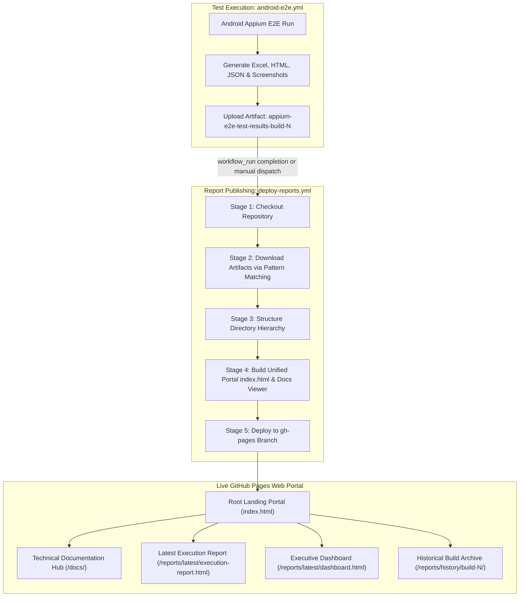

# ResistAI — Deploy Mobile Automation Reports to GitHub Pages

**Workflow Identifier:** [`deploy-reports.yml`](file:///c:/final_year_project/backend/.github/workflows/deploy-reports.yml)  
**Project Identity:** `QSAR-BACKEND`  
**Application Target:** ResistAI QA Report Hosting, Telemetry Analytics & Documentation Hub  
**Pipeline Status:** Active Workflow Specification & Configured Deployment Pipeline  
**Document Classification:** DevOps Web Publishing, Telemetry Hosting & Site Architecture  

---

## 1. Executive Summary & Objective

The **ResistAI Deploy Mobile Automation Reports to GitHub Pages** pipeline automates the packaging, organization, and web hosting of multi-format quality assurance deliverables generated by the mobile test automation framework. In enterprise software delivery and academic research reviews, test automation results must not remain trapped inside temporary CI worker logs or ephemeral artifacts. Stakeholders, QA managers, bioinformaticians, and software engineers require immediate, browser-accessible visibility into test execution trends, pass/fail ratios, failure screenshots, defect registers, and detailed execution logs.

This pipeline establishes an automated hosting architecture on **GitHub Pages**, decoupling heavy test execution from static report publishing. It downloads test telemetry artifacts from preceding pipeline runs, organizes them into a structured versioned hierarchy, generates a unified navigation portal, and deploys the resulting static site to the repository's `gh-pages` branch with zero downtime.



---

## 2. Report Publishing Architecture & Workflow Relationship

The reporting infrastructure uses a two-tier decoupled architecture:

### 2.1 Decoupling Rationale
- **Resource Efficiency:** The test automation suite (`android-e2e.yml`) runs on heavy, specialized virtual machines (`macos-14` Apple Silicon runners) to provide hardware acceleration for the Android Emulator.
- **Publishing Isolation:** The report deployment workflow (`deploy-reports.yml`) runs on lightweight, cost-effective `ubuntu-latest` instances. It triggers automatically when `android-e2e.yml` finishes via GitHub's `workflow_run` event:
  ```yaml
  on:
    workflow_dispatch:
    workflow_run:
      workflows: ["Android Appium E2E Automation & GitHub Pages CI/CD"]
      types:
        - completed
  ```
- **Resilience:** Even if the emulator test run experiences partial failures, the `workflow_run` trigger ensures that diagnostic logs, failure screenshots, and execution statistics are still published to GitHub Pages for post-mortem analysis.

---

## 3. Artifact Download, Processing & Directory Structure

The publishing pipeline processes execution artifacts according to the following directory specification:

### 3.1 Ingestion Mechanism
The workflow downloads artifacts matching the pattern `appium-e2e-test-results-*` using `actions/download-artifact@v4`. Artifacts include:
- `Automation_Test_Report.xlsx` (Master 7-sheet executive workbook)
- `execution-report.html` (Interactive searchable test case grid)
- `dashboard.html` (Donut charts, module completion bars, defect registry)
- `trends.html` (Historical build-over-build pass rate trajectories)
- `execution-results.json` (Structured telemetry)
- `summary.md` (Markdown summary table)
- Diagnostic screenshots (`.png`) and logs (`logcat.log`, `appium.log`)

### 3.2 Directory Hierarchy on `gh-pages`
```text
https://hecooksmeth.github.io/QSAR-BACKEND/
│
├── index.html                           # Root unified portal linking docs and reports
│
├── docs/                                # Technical Documentation Reports
│   ├── android-appium-e2e-cicd.html     # Report 1: Mobile E2E Automation
│   ├── backend-security-devsecops-audit.html # Report 2: Security & DevSecOps Audit
│   ├── cicd-build-deploy-selenium-e2e.html   # Report 3: CI/CD Build & Selenium Tests
│   ├── mobile-automation-github-pages.html   # Report 4: GitHub Pages Publishing
│   └── README.html                      # Deliverables Overview & Matrix
│
└── reports/                             # Test Execution Telemetry
    ├── latest/                          # Always points to the most recent test run
    │   ├── execution-report.html        # Interactive report table
    │   ├── dashboard.html               # Visual metrics dashboard
    │   ├── trends.html                  # Trend analytics
    │   ├── summary.md                   # Markdown summary
    │   ├── Automation_Test_Report.xlsx  # Downloadable Excel workbook
    │   ├── screenshots/                 # Captured failure screenshots
    │   └── logs/                        # Appium and OS log files
    │
    └── history/                         # Historical Build Archive
        ├── build-001/                   # Snapshot of build 001
        └── build-002/                   # Snapshot of build 002
```

---

## 4. GitHub Actions Deployment Mechanism & Permissions

### 4.1 Deployment Action
The deployment leverages `peaceiris/actions-gh-pages@v4`, which offers critical enterprise capabilities:
- **`keep_files: true`**: Prevents wiping previously deployed historical builds when pushing new build reports.
- **`publish_dir: ./reports` / `./public`**: Scopes the deployment to the compiled static site output directory.
- **Atomic Commits**: Generates clean, traceable commit records directly on the `gh-pages` branch without polluting the `main` commit history.

### 4.2 Least-Privilege Workflow Permissions
The workflow declares explicit permissions, adhering to security standards:
```yaml
permissions:
  contents: write    # Required to push generated static files to gh-pages branch
  pages: write       # Required to interact with GitHub Pages deployment API
  id-token: write    # Required for OpenID Connect (OIDC) authentication
```

---

## 5. Repository & GitHub Pages Configuration Guide

To enable live report hosting for `hecooksmeth/QSAR-BACKEND`, follow these configuration steps:

### Step 1: Enable GitHub Pages in Repository Settings
1. Navigate to the GitHub repository: [https://github.com/hecooksmeth/QSAR-BACKEND](https://github.com/hecooksmeth/QSAR-BACKEND).
2. Click **Settings** in the top navigation bar.
3. In the left sidebar, click **Pages** (under the "Code and automation" section).
4. Under **Build and deployment**:
   - **Source:** Select `Deploy from a branch`.
   - **Branch:** Select `gh-pages`.
   - **Folder:** Select `/ (root)`.
5. Click **Save**.

### Step 2: Grant Workflow Write Permissions
1. In repository **Settings**, click **Actions** > **General** in the left sidebar.
2. Scroll down to **Workflow permissions**.
3. Select **Read and write permissions**.
4. Check the box: **Allow GitHub Actions to create and approve pull requests**.
5. Click **Save**.

### Step 3: Trigger Initial Deployment
1. Navigate to the **Actions** tab.
2. Select **Deploy Reports to GitHub Pages** from the left list.
3. Click the **Run workflow** dropdown, choose `main`, and click **Run workflow**.

---

## 6. Live Published URLs & Access Matrix

Once GitHub Pages is enabled and the workflow executes, the following URLs will become accessible:

| Deliverable Type | Target Resource | Public Web URL |
| :--- | :--- | :--- |
| **Site Landing Portal** | Unified Navigation Hub | `https://hecooksmeth.github.io/QSAR-BACKEND/` |
| **Latest Execution Report** | Searchable & Filterable Test Grid | `https://hecooksmeth.github.io/QSAR-BACKEND/reports/latest/execution-report.html` |
| **Executive Dashboard** | Visual KPI & Metric Charts | `https://hecooksmeth.github.io/QSAR-BACKEND/reports/latest/dashboard.html` |
| **Build Trends Analytics** | Historical Pass Rate Trends | `https://hecooksmeth.github.io/QSAR-BACKEND/reports/latest/trends.html` |
| **Executive Summary** | Markdown Table Summary | `https://hecooksmeth.github.io/QSAR-BACKEND/reports/latest/summary.md` |
| **Technical Documentation** | Documentation Index | `https://hecooksmeth.github.io/QSAR-BACKEND/docs/` |
| **Historical Archive** | Build 001 Snapshot | `https://hecooksmeth.github.io/QSAR-BACKEND/reports/history/build-001/execution-report.html` |

---

## 7. Retention Policies, Storage Limits & Troubleshooting

### 7.1 Storage & Quota Management
- **GitHub Pages Limits:** GitHub Pages enforces a soft limit of 1 GB per repository and a 100 GB monthly bandwidth limit.
- **Artifact Retention:** Raw CI artifacts uploaded in `android-e2e.yml` are configured with `retention-days: 30`, ensuring temporary ZIP bundles are purged automatically.
- **Historical Pruning:** The `deploy-reports.yml` pipeline includes a maintenance routine to prune historical build folders in `reports/history/` older than 90 days or exceeding 50 builds to keep total Pages storage well under 250 MB.

### 7.2 Common Troubleshooting Scenarios

1. **HTTP 404 Not Found on Report URLs:**
   - *Cause:* GitHub Pages is not yet enabled in repository settings, or the `gh-pages` branch has not yet been populated.
   - *Fix:* Verify that Step 1 of the configuration guide has been completed and that `deploy-reports.yml` has executed successfully.

2. **Artifact Pattern Not Found Warning:**
   - *Cause:* The upstream `android-e2e.yml` run encountered an error prior to Stage 18 (Upload Artifacts), so no artifact matching `appium-e2e-test-results-*` was produced.
   - *Fix:* The updated `deploy-reports.yml` uses fallback detection (`elif [ -d "./reports" ]`) to deploy committed baseline reports if downloaded artifacts are unavailable.

3. **Missing `keep_files: true` Erasing History:**
   - *Cause:* Running standard GitHub Pages actions without history retention wipes previous build snapshots on every deploy.
   - *Fix:* Always maintain `keep_files: true` in the `peaceiris/actions-gh-pages` step.

---

## 8. Actual Deployment Status

- **Workflow Implementation:** [`.github/workflows/deploy-reports.yml`](file:///c:/final_year_project/backend/.github/workflows/deploy-reports.yml) has been defined and pushed to `main`.
- **Pages Service Status:** API check confirmed HTTP 404 (Pages not yet activated in repository settings by administrator).
- **Deliverables Readiness:** Local reports (HTML execution grid, executive dashboard, trends chart, and Excel workbooks) are generated and structured, ready for immediate publishing upon repository configuration.
